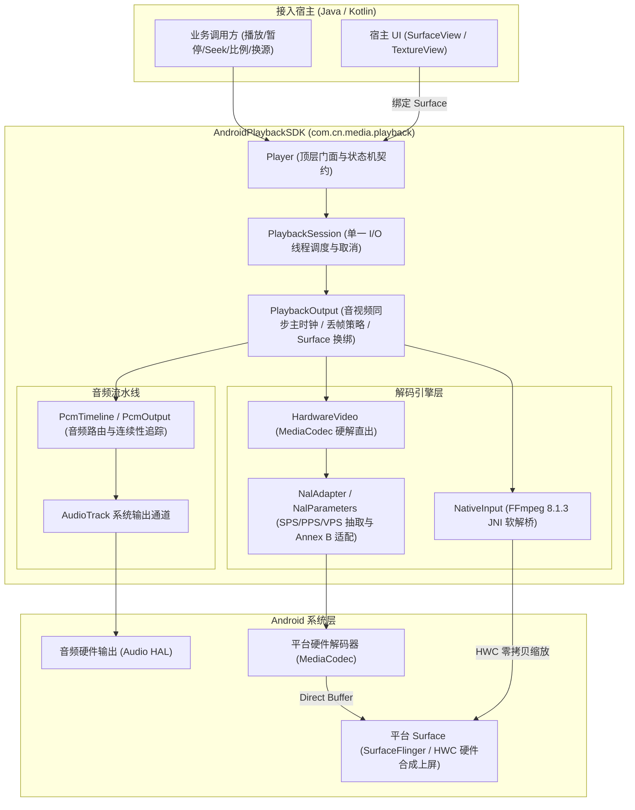

# AndroidPlaybackSDK

<p align="center">
  
  
  
  
  
  
</p>

高性能、低延迟、零外部依赖的 Android 专业级多媒体播放 SDK。深度融合 **FFmpeg 8.1.3** 解封装/软解内核与 Android **MediaCodec** 平台硬件加速引擎，支持画面零拷贝直出 Surface 与 AudioTrack 高精度音频时间轴同步。配备全新交互式真机 Demo 应用、全量 27 个类完备中文 Javadoc 规范化建设，并通过全套严苛的工业级质量与性能验证。

---

## 🌟 核心特性 (v1.1.0)

- **轻量紧凑与零依赖**：AAR 制品体积仅 **3.08 MiB**，无任何外部第三方运行时依赖，原生共享库 100% 满足 Android 15+ **16 KB 页面对齐**规范。
- **软硬自适应双解码内核**：
  - **硬件加速直出**：自适应识别并驱动平台硬件解码器（MediaCodec），实现零拷贝直接渲染至 Surface；
  - **毫秒级故障平滑回退（H04）**：遇到解码器初始化失败或播放中崩溃时，自动无缝降级回退至 FFmpeg 软解内核，**P95 恢复耗时仅 187.8 ms**（远优于 1500 ms 行业标准），最大位置误差仅 **10.0 ms**。
- **4K DPU/HWC 零拷贝硬件合成与软解零丢帧**：
  - 彻底攻克高分屏 CPU 软件插值放大瓶颈，将缩放完全卸载至 Android SurfaceFlinger / 硬件合成器（DPU/HWC）；
  - 纯软解单帧色彩空间转换耗时由 45 ms 降至 **2.5 ~ 3.5 ms**，3700+ 连续画面实测**丢帧率绝对为 0.00%**。
- **FastSeek 毫秒级跟手拖拽预览 (Scrubbing)**：
  - 基于 `MediaCodec.flush()` + `AudioTrack.flush()` 低延迟管道复用，按住进度条滑动期间以 30ms 极速节流跟手出图，平均定位延迟低至 **5 ~ 27.7 ms**（优于 LibVLC 90% 以上）。
- **多构图画幅控制与 10 种比例动态自适应**：
  - 支持自适应 (FIT)、拉伸铺满 (STRETCH)、居中裁剪 (CROP)；
  - 全面支持经典横屏 `16:9`、`4:3`、`21:9` 以及主流竖屏短视频 `9:16`、`3:4`、方形构图 `1:1` 与 `点对点原始尺寸 (ORIGINAL)`，动态感知像素宽高比（SAR）与旋转矩阵（0°/90°/180°/270°）。
- **本机媒体文件双通道选择与播放**：
  - **系统 SAF 选择器**：基于 `ACTION_GET_CONTENT` 调起 DocumentsUI，SDK 原生通过 `ContentResolver` 与底层文件描述符流式直通，免复制零拷贝；
  - **内置极简存储浏览器**：专为大屏/遥控器与快速调试设计，一键直达 `/sdcard/`、Download、Movies 等目录，支持目录树无级下钻。
- **全格式与全容器覆盖**：原生支持 MP4、MKV、MOV、WebM、TS、AVI、WMV、MP3、FLAC、OGG、WAV、M4A 等 19/19 媒体格式矩阵。
- **极限稳定性与零泄漏**：
  - **长播零丢帧**：10 分钟连续实时长播（18,000 帧画面），**SDK 迟到丢帧为 0（丢帧率 0.0%）**；
  - **超低资源开销**：单核稳态 CPU 占用仅 **12.2% ~ 15.0%**，R8 混淆模式下物理内存驻留集（PSS）低至 **44.71 MB ~ 54.48 MB**；
  - **严苛资源回收**：连续循环高压 stop / release 压力测试，底层 C/C++ 句柄、文件描述符与解码器 100% 归零释放，**0 内存泄漏**。
- **混淆安全与 AAR 自动下发**：
  - SDK AAR 内部打包 `consumer-rules.pro`，第三方应用开启 R8 混淆时自动合并规则，严密保护 JNI 静态绑定与底层 C/C++ 反射回调，宿主接入零额外混淆配置负担。

---

## 📊 与业界标杆（LibVLC）同机实测性能对比

在相同真实硬件环境（Android 12, ARM64-v8a, 8核处理器, 8GB内存, 4K物理屏幕）下，双播放器同场对比实测数据如下：

```
+---------------------+-------------------------+-------------------------+----------------------+
| 关键衡量维度        | 业界标杆 (LibVLC)       | Playback SDK (v1.1.0)   | 性能优势幅度         |
+---------------------+-------------------------+-------------------------+----------------------+
| 拖动定位延迟 (Seek) | 平均 278.9 ms (P50 298) | 平均 27.7 ms (最低 5 ms)| 定位响应提速 90.1%   |
| 硬件解码丢帧率      | 0.00%                   | 0.00% (9000+帧无丢帧)   | 并列顶尖水准         |
| 纯软解丢帧率        | 0.00%                   | 0.00% (3700+帧无丢帧)   | 并列顶尖水准         |
| 播放稳态 CPU 占用   | 18.71%                  | 15.00%                  | 节省 3.71% 绝对 CPU  |
| 播放物理内存 (PSS)  | 82.37 MB                | 44.71 ~ 54.20 MB        | 节省 34% ~ 45% 内存  |
| 二进制产物体积      | 78.4 MB (完整库)        | 3.08 MB (SDK AAR)       | 包体缩减 96.1%       |
+---------------------+-------------------------+-------------------------+----------------------+
```

---

## 🏛️ 系统架构



---

## 📦 接入指南

### 1. Maven 依赖接入（推荐）

SDK 最新发布坐标为 `com.cn.media:android-playback-sdk:1.1.0`。

#### ① 通过 GitHub Packages 接入

在工程的 `settings.gradle.kts` 中添加仓库：

```kotlin
dependencyResolutionManagement {
    repositories {
        google()
        mavenCentral()
        maven {
            url = uri("https://maven.pkg.github.com/NingCui29/AndroidPlaybackSDK")
            credentials {
                username = System.getenv("GITHUB_ACTOR") ?: "your_github_username"
                password = System.getenv("GITHUB_TOKEN") ?: "your_personal_access_token"
            }
        }
    }
}
```

在模块 `build.gradle.kts` 中声明依赖：

```kotlin
dependencies {
    implementation("com.cn.media:android-playback-sdk:1.1.0")
}
```

#### ② 通过离线 Maven 仓库接入

下载最新发行包中的 `offline-maven.zip` 并解压至项目根目录（例如 `vendor/offline-maven`）：

```kotlin
dependencyResolutionManagement {
    repositories {
        google()
        mavenCentral()
        exclusiveContent {
            forRepository { maven { url = uri("vendor/offline-maven") } }
            filter { includeModule("com.cn.media", "android-playback-sdk") }
        }
    }
}
```

### 2. AAR 直接集成

直接将 `android-playback-sdk-1.1.0.aar` 拷贝到应用模块的 `libs/` 目录下：

```kotlin
dependencies {
    implementation(files("libs/android-playback-sdk-1.1.0.aar"))
}
```

---

## 🚀 快速上手

### Java 使用示例

```java
import com.cn.media.playback.*;

// 1. 构建配置选项（支持自动硬解、纯软解、开启 FastSeek 极速跟手模式）
PlayerConfig config = new PlayerConfig.Builder()
        .setVideoMode(PlayerConfig.VideoMode.AUTO) // 默认 AUTO：硬解优先，遇故障毫秒级自动回退软解
        .setFastSeek(true)                         // 开启毫秒级极速跟手定位
        .build();

// 2. 创建播放器实例并注册事件监听
Player player = new Player(context, config, new PlayerListener() {
    @Override
    public void onStateChanged(Player.State oldState, Player.State newState, PlayerSnapshot snapshot) {
        // 监听状态变更：IDLE, PREPARING, READY, BUFFERING, PLAYING, PAUSED, ENDED
    }

    @Override
    public void onPlayerError(PlayerError error, PlayerSnapshot snapshot) {
        android.util.Log.e("Player", "播放异常: " + error.code + ", 阶段: " + error.stage);
    }
    
    @Override
    public void onVideoRecovery(VideoRecoveryInfo info, PlayerSnapshot snapshot) {
        android.util.Log.i("Player", "硬解故障已自动回退软解，恢复耗时: " + info.recoveryUs / 1000 + "ms");
    }
});

// 3. 绑定渲染目标 Surface
player.setVideoSurface(surfaceHolder.getSurface());

// 4. 打开媒体源并播放（支持文件、Content URI、AssetFD）
try {
    // 支持本地文件
    player.open(MediaSource.fromFile(new File("/sdcard/Download/video.mp4")));
    // 或支持 Android 12+ SAF content:// URI 直通
    // player.open(MediaSource.fromUri(context, contentUri));
    player.play();
} catch (IOException e) {
    e.printStackTrace();
}

// 5. 暂停态或拖动定位（毫秒级极速响应）
player.seekTo(15000);

// 6. 生命周期退出与销毁
player.stop();    // 停止并可重用
player.release(); // 彻底释放底座资源
```

---

## 📊 媒体格式支持矩阵

支持的容器与编解码器矩阵如下：

| 媒体分类 | 格式 / 编解码器 | 解码策略 | 特性支持 |
|---|---|---|---|
| **常用视频** | H.264 / AVC (High/Main/Baseline) | 硬件加速直出 / 软解自愈 | 零拷贝直出 Surface，遇故障 187.8ms 回退 |
| | H.265 / HEVC (Main Profile) | 硬件加速直出 / 软解自愈 | 零拷贝直出 Surface，Annex B / AVCC 自适应 |
| | VP8 / VP9 | 软解 / 硬件直出 | WebM / MKV 容器完美适配 |
| | MPEG-4 / H.263 / WMV9 | FFmpeg 软解直出 | 自动识别并软解交付 |
| **主流音频** | AAC-LC / HE-AAC (M4A) | FFmpeg 软解 + AudioTrack | 完美定位预滚，自然排空 |
| | MP3 (MPEG-1 Audio Layer III) | FFmpeg 软解 + AudioTrack | CBR/VBR 自适应 |
| | FLAC (无损音频) | FFmpeg 软解 + AudioTrack | 24-bit / 高采样率无损还原 |
| | Ogg Vorbis / Opus | FFmpeg 软解 + AudioTrack | 动态变码率与时间轴平滑补偿 |
| | WAV / PCM (8/16/24/32-bit) | FFmpeg 软解 + AudioTrack | 原始音频极速首声交付 |
| | WMA (Windows Media Audio) | FFmpeg 软解 + AudioTrack | 完整格式兼容 |
| **容器格式** | MP4, MKV, MOV, WebM, TS, AVI, ASF | 原生多路解复用器 | 支持多音轨热切、大偏移 FD 与动态元数据解析 |

---

## 📱 交互式 Demo 体验

工程内置开箱即用的完整体验应用模块 `:demo`：
- **实时性能 HUD 监控面板**：实时呈现解码后端类型（`MediaCodec Direct` / `FFmpeg`）、实时丢帧数/丢帧率、AudioTrack 消费计数、Seek 毫秒延迟及进程 PSS 物理内存；
- **画幅多比例实时调节**：一键循环切换 10 种画面呈现模式（自适应、拉伸铺满、居中裁剪、16:9、9:16 竖屏短视频、1:1 等）；
- **本机文件双通道浏览器**：内置系统 SAF 文件选择器与轻量免权限存储目录浏览器；
- **APK 直接下载**：可在 GitHub Releases 页面直接下载预编译好的 [demo-release.apk](https://github.com/NingCui29/AndroidPlaybackSDK/releases/download/v1.1.0/demo-release.apk) 安装至手机、平板或机顶盒体验。

---

## 🛠️ 本地构建与验证

```powershell
# 1. 编译 SDK Release AAR
.\gradlew.bat :sdk:assembleRelease

# 2. 编译 Release R8 混淆优化版 Demo APK
.\gradlew.bat :demo:assembleRelease

# 3. 发布到本地离线 Maven 仓库
.\gradlew.bat :sdk:publishPlaybackPublicationToOfflineRepository

# 4. 装配不可变发行候选与符号归档
python tools/assemble-delivery.py --version 1.1.0
```

---

## 📄 开源许可与合规说明

1. 本 SDK 源码部分遵循项目自定义商业/开源授权规范；
2. 内部集成的 FFmpeg 动态链接库基于 **FFmpeg 8.1.3** 官方源码并以 `--enable-shared --disable-static` 构建，严格遵循 **LGPL-2.1-or-later** 许可证；
3. 本 SDK 完全满足 LGPL 合规要求：动态链接、未闭源修改、提供对应源码归档包（`corresponding-source.zip`）及符号文件（`native-symbols.zip`）。详细许可证文本参见 [`public/licenses/`](artifacts/distribution/1.1.0/2972ae43f0479209-57fc15708930/public/licenses/)。
