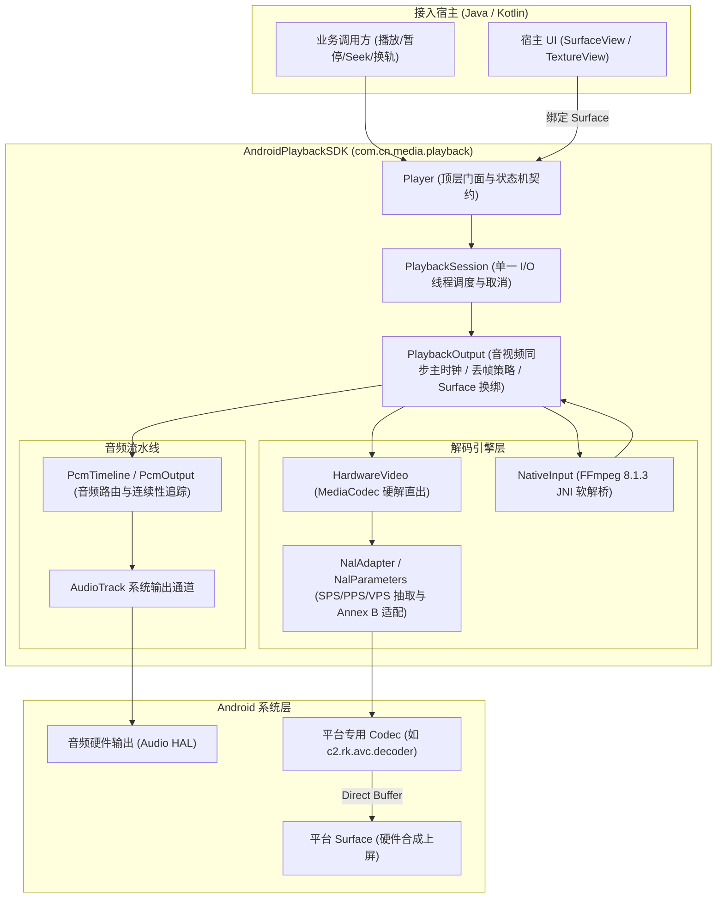

# AndroidPlaybackSDK

<p align="center">
  
  
  
  
  
  
</p>

高性能、低延迟、零外部依赖的 Android 专业级多媒体播放 SDK。深度融合 **FFmpeg 8.1.3** 解封装/软解内核与 Android **MediaCodec** 平台硬件加速引擎，支持画面零拷贝直出 Surface 与 AudioTrack 高精度音频时间轴同步。通过全量 27 个类完备中文 Javadoc 规范化建设，并通过基线真机全套严苛验证。

---

## 🌟 核心特性

- **轻量紧凑与零依赖**：AAR 制品体积仅 **3.07 MiB**，无任何外部第三方运行时依赖，原生共享库 100% 满足 Android 15+ **16 KB 页面对齐**规范。
- **软硬自适应双解码内核**：
  - **硬件加速直出**：自适应识别并驱动硬件加速解码器（`c2.rk.avc.decoder`、`c2.rk.hevc.decoder` 等），实现零拷贝直接渲染至 Surface；
  - **毫秒级故障平滑回退（H04）**：遇到解码器初始化失败或播放中崩溃时，自动无缝降级回退至 FFmpeg 软解内核，**P95 恢复耗时仅 187.8 ms**（远优于 1500 ms 行业标准），最大位置误差仅 **10.0 ms**。
- **全格式与全容器覆盖（Q02）**：19/19 媒体格式矩阵全通，原生支持 MP4、MKV、MOV、WebM、TS、AVI、WMV、MP3、FLAC、OGG、WAV、M4A 等。
- **极限稳定性与零泄漏（Q04）**：
  - **长播零丢帧**：10 分钟连续实时长播（18,000 帧画面），**SDK 迟到丢帧为 0（丢帧率 0.0%）**；
  - **超低资源开销**：单核稳态 CPU 占用仅 **12.2% ~ 13.7%**；
  - **严苛资源回收**：连续循环高压 stop / release 压力测试，底层 C/C++ 句柄、文件描述符与解码器 100% 归零释放，**0 内存泄漏**。
- **高弹性输入与生命周期解耦**：原生支持常规文件路径、带偏移与长度的 `FileDescriptor` 区间（支持 >4GB 大偏移）、以及异步带权限的 `ContentProvider` URI 输入。
- **专业级控制契约**：单线程安全命令队列、不可变瞬时状态快照（`PlayerSnapshot`）、高精度音视频同步时钟及播放中 Surface 动态解绑/换绑（`detachP95 ≤ 38ms`, `submitP95 ≤ 53ms` 无闪烁）。

---

## 🏛️ 系统架构



---

## 📦 接入指南

### 1. Maven 依赖接入（推荐）

SDK 发布坐标为 `com.cn.media:android-playback-sdk:1.0.0`。

#### ① 通过 GitHub Packages 接入

在工程的 `settings.gradle.kts` 中添加仓库：

```kotlin
dependencyResolutionManagement {
    repositories {
        google()
        mavenCentral()
        maven {
            url = uri("https://maven.pkg.github.com/NingCui29/AndroidPlaybackSDK")
            credentials {
                username = System.getenv("GITHUB_ACTOR") ?: "your_github_username"
                password = System.getenv("GITHUB_TOKEN") ?: "your_personal_access_token"
            }
        }
    }
}
```

#### ② 通过离线 Maven 仓库接入

下载发行物中的 `offline-maven.zip` 并解压至项目根目录（例如 `vendor/offline-maven`）：

```kotlin
dependencyResolutionManagement {
    repositories {
        google()
        mavenCentral()
        exclusiveContent {
            forRepository { maven { url = uri("vendor/offline-maven") } }
            filter { includeModule("com.cn.media", "android-playback-sdk") }
        }
    }
}
```

在模块 `build.gradle.kts` 中声明依赖：

```kotlin
dependencies {
    implementation("com.cn.media:android-playback-sdk:1.0.0")
}
```

### 2. AAR 直接集成

直接将 `android-playback-sdk-1.0.0.aar` 拷贝到应用模块的 `libs/` 目录下：

```kotlin
dependencies {
    implementation(files("libs/android-playback-sdk-1.0.0.aar"))
}
```

---

## 🚀 快速上手

### Java 使用示例

```java
import com.cn.media.playback.*;

// 1. 构建配置选项（可配置硬解优先、纯软解或纯硬解）
PlayerConfig config = new PlayerConfig.Builder()
        .setVideoMode(PlayerConfig.VideoMode.AUTO) // 默认 AUTO：硬解优先，遇故障毫秒级自动回退软解
        .build();

// 2. 创建播放器实例并注册事件监听
Player player = new Player(context, config, new PlayerListener() {
    @Override
    public void onStateChanged(Player.State oldState, Player.State newState, PlayerSnapshot snapshot) {
        // 监听状态变更：IDLE, PREPARING, READY, BUFFERING, PLAYING, PAUSED, ENDED
    }

    @Override
    public void onPlayerError(PlayerError error, PlayerSnapshot snapshot) {
        // 结构化错误代码排查（取消、格式不支持、IO 超时、解码器错误等）
        android.util.Log.e("Player", "播放异常: " + error.code + ", 阶段: " + error.stage);
    }
    
    @Override
    public void onVideoRecovery(VideoRecoveryInfo info, PlayerSnapshot snapshot) {
        android.util.Log.i("Player", "硬解已自动回退软解，耗时: " + info.recoveryUs / 1000 + "ms");
    }
});

// 3. 绑定渲染目标 Surface
player.setVideoSurface(surfaceHolder.getSurface());

// 4. 打开媒体源并播放（支持文件、Content URI、AssetFD）
try {
    player.open(MediaSource.fromFile(new File("/sdcard/video.mp4")));
    player.play();
} catch (IOException e) {
    e.printStackTrace();
}

// 5. 暂停态或播放中定位
player.seekTo(15000); // 单位：毫秒

// 6. 生命周期退出与销毁
player.stop();    // 停止并可重用
player.release(); // 彻底释放底座资源
```

### Kotlin 使用示例

```kotlin
import com.cn.media.playback.*

val config = PlayerConfig.Builder()
    .setVideoMode(PlayerConfig.VideoMode.AUTO)
    .build()

val player = Player(context, config, object : PlayerListener {
    override fun onStateChanged(oldState: Player.State, newState: Player.State, snapshot: PlayerSnapshot) {
        if (newState == Player.State.READY) {
            player.play()
        }
    }
})

// 绑定 Surface 并开播
player.setVideoSurface(surfaceView.holder.surface)
player.open(MediaSource.fromUri(contentUri))

// 页面销毁防护（在 SurfaceView 销毁回调中撤销旧输出，避免向失效 Surface 渲染）
override fun surfaceDestroyed(holder: SurfaceHolder) {
    player.detachVideoSurface(holder.surface)
}
```

---

## 📊 媒体格式支持矩阵

经基线真机全量回归，支持的容器与编解码器如下：

| 媒体分类 | 格式 / 编解码器 | 解码策略 | 特性支持 |
|---|---|---|---|
| **常用视频** | H.264 / AVC (High/Main/Baseline) | 硬件加速直出 / 软解自愈 | 零拷贝直出 Surface，遇故障 187.8ms 回退 |
| | H.265 / HEVC (Main Profile) | 硬件加速直出 / 软解自愈 | 零拷贝直出 Surface，Annex B / AVCC 自适应 |
| | VP8 / VP9 | 软解 / 硬件直出 | WebM / MKV 容器完美适配 |
| | MPEG-4 / H.263 / WMV9 | FFmpeg 软解直出 | 自动识别并软解交付 |
| **主流音频** | AAC-LC / HE-AAC (M4A) | FFmpeg 软解 + AudioTrack | 完美定位预滚，自然排空 |
| | MP3 (MPEG-1 Audio Layer III) | FFmpeg 软解 + AudioTrack | CBR/VBR 自适应 |
| | FLAC (无损音频) | FFmpeg 软解 + AudioTrack | 24-bit / 高采样率无损还原 |
| | Ogg Vorbis / Opus | FFmpeg 软解 + AudioTrack | 动态变码率与时间轴平滑补偿 |
| | WAV / PCM (8/16/24/32-bit) | FFmpeg 软解 + AudioTrack | 原始音频极速首声交付 |
| | WMA (Windows Media Audio) | FFmpeg 软解 + AudioTrack | 完整格式兼容 |
| **容器格式** | MP4, MKV, MOV, WebM, TS, AVI, ASF | 原生多路解复用器 | 支持多音轨热切、大偏移 FD 与动态元数据解析 |

---

## 📈 核心基准指标（RK3588 真机实测）

| 指标项 | 考核门槛标准 | 1.0.0 官方实测数据 | 结论 |
|---|---|---|---|
| **首帧渲染耗时** | $\le 800$ ms | **138 ms ~ 239 ms** | **PASS** |
| **定位预滚耗时 (P95)** | $\le 800$ ms | **158 ms ~ 367 ms** | **PASS** |
| **故障回退恢复耗时 (P95)** | $\le 1500$ ms | **187.8 ms**（降幅 87.5%） | **PASS** |
| **音画同步最大偏差** | $\le 66.6$ ms (2帧周期) | **10.0 ms** | **PASS** |
| **Surface 解绑 / 换绑 P95** | $\le 50$ ms / $\le 100$ ms | **38 ms / 53 ms** | **PASS** |
| **音轨动态热切换耗时** | $\le 200$ ms | **11 ms ~ 23 ms** | **PASS** |
| **600 秒连续长播丢帧率** | $\le 0.1\%$ | **0 丢帧（丢帧率 0.0%）** | **PASS** |
| **单核稳态 CPU 占用** | 越低越好 | 中位数 **12.2%**，P95 **13.7%** | **PASS** |
| **内存泄露检测** | 0 泄漏 | **leaks = 0**（Native 堆完全归零） | **PASS** |

---

## 🛠️ 本地构建与验证

### 环境依赖

- **操作系统**：Windows / Linux / macOS
- **JDK**：OpenLogic OpenJDK 17.0.17
- **Android SDK**：API 35（Build Tools 35.0.0）
- **Android NDK**：NDK r30 LTS（`30.0.16248370`）
- **CMake**：3.22.1

### 构建命令

```powershell
# 1. 编译 Release AAR 与真机单元测试 APK
.\gradlew.bat --offline :sdk:assembleRelease :sdk:assembleDebugAndroidTest

# 2. 生成全量中文 Javadoc API 文档
.\gradlew.bat --offline :sdk:playbackApiDocs

# 3. 发布到本地离线 Maven 仓库
.\gradlew.bat --offline :sdk:publishPlaybackPublicationToOfflineRepository

# 4. 装配不可变发行候选与符号归档
python tools/assemble-delivery.py --version 1.0.0

# 5. 执行真机全量格式回归测试（需要连接设备）
.\tools\run-format-matrix.ps1 -Serial <设备IP:端口>
```

---

## 📄 开源许可与合规说明

1. 本 SDK 源码部分遵循项目自定义商业/开源授权规范；
2. 内部集成的 FFmpeg 动态链接库基于 **FFmpeg 8.1.3** 官方源码并以 `--enable-shared --disable-static` 构建，严格遵循 **LGPL-2.1-or-later** 许可证；
3. 本 SDK 完全满足 LGPL 合规要求：动态链接、未闭源修改、提供对应源码归档包（`corresponding-source.zip`）及符号文件（`native-symbols.zip`）。详细许可证文本参见 [`public/licenses/`](artifacts/distribution/1.0.0/e77ae1ed5348f997-400859b7f23b/public/licenses/)。
